# 01 — Agent Runtime Architecture · بنية منصة الوكلاء

**Agent Runtime Foundation Phase 6 · v1.0 — a production-grade, generic
hosting runtime for thousands of FUTURE agents. Zero agents loaded, zero
business logic, zero skills imported — the runtime is the theatre, the
actors arrive in a later phase.**

---

## Position & composition

```mermaid
flowchart TB
    subgraph CORE["Frozen Core (immutable)"]
        R[Seven-layer runtime stack]
    end
    subgraph SHELL["Adaptive Shell"]
        P1["Phase 1 · manifests"]
        POP["Phase 5 · population registries"]
        AR["Phase 6 · AGENT RUNTIME<br/>registry · lifecycle · execution ·<br/>context · events · observability · security"]
        P1 -->|"agentManifestSchema (frozen, wrapped)"| AR
        POP -->|"generic primitives reused:<br/>Health · Permissions · Categories ·<br/>metadata/contract/policy schemas · VersionTimeline"| AR
    end
    SHELL -->|zero imports| CORE
    style AR fill:#1a2436,stroke:#00d4ff
```

Reuse is deliberate — **one definition per concept**: health (5 states),
permissions (8 actions, deny-by-default), categories (12 seeded), the
metadata/dependency/contract/policy schemas and the version timeline all
come from the population layer unchanged. New here: the 10-state agent
lifecycle, the 8-event agent bus, execution contexts, observability
(traces/metrics/logs), the security model (policy checks, approval hooks,
audit trail) and the execution coordinator.

## Module map

| Module | Sections | Responsibility |
|---|---|---|
| `types.ts` | 03–06 | closed vocabularies: 10 lifecycle states, 7 execution modes, 8 events; injected `Clock`/`Monotonic`/`IdFactory` |
| `records.ts` | 01, 02 | `AgentRecord` (governed view) + `AgentRuntimeManifest` wrapping the frozen Phase-1 agent manifest |
| `lifecycle.ts` | 03 | machine + `OPERATIONAL_STATES` (running/paused — protocol territory) |
| `registry.ts` | 01 | governed store; static-factory `OperationalGate` (no public back door) |
| `events.ts` | 06 | journaled, handler-isolated bus |
| `execution-context.ts` | 07 | identity/session/memory/permissions/correlation/trace/audit |
| `observability.ts` | 08 | `TraceCollector` (monotonic spans), `MetricsRegistry`, `LogJournal` |
| `security.ts` | 09 | authorization, policy decisions, approval hooks, `AuditTrail` |
| `execution.ts` | 04 | `ExecutionCoordinator` — 7 modes over one governed core |
| `validation.ts` | 01/02 | fail-closed admission validator |
| `runtime.ts` | all | `createAgentRuntime(options)` facade |

## Laws

1. **Empty by design** — no invoker installed ⇒ execution fails honestly
   ("the runtime hosts no agents yet"); the invoker installs exactly once.
2. **No operational back door** — `transition()` refuses running/paused;
   the `OperationalGate` is created by a static factory with private access
   and handed only to the coordinator inside the facade.
3. **Deny-by-default everywhere** — execution needs the `execution`
   permission, approval needs `approval`; refusals are audited.
4. **Deterministic** — wall time, monotonic ticks and ids are all injected.
5. **Observable by construction** — every invocation produces a span, a
   metric sample, journal events and an audit entry; nothing runs unseen.
