# 02 — Execution Architecture & Flow · معمارية التنفيذ

**Section 04 implementation — seven modes over ONE governed core path.**

---

## The seven modes

| Mode              | Shape                             | Semantics                                                                 |
| ----------------- | --------------------------------- | ------------------------------------------------------------------------- |
| `single`          | one agent, one input              | the atomic unit every other mode composes                                 |
| `sequential`      | ordered steps, independent inputs | fail-fast: a failed step stops the chain                                  |
| `parallel`        | branches fan out                  | all invocations race; result aggregates every branch                      |
| `pipeline`        | stages chain                      | each stage's OUTPUT is the next stage's INPUT                             |
| `broadcast`       | one input → many agents           | same payload delivered to every agent                                     |
| `event-driven`    | bus event → files a request       | **never auto-runs** — an event creates a _pending request_, humans decide |
| `approval-driven` | wraps an inner plan               | can never `execute()` directly; request → approve → run                   |

## The governed core (every invocation, every mode)

```mermaid
flowchart TB
    P[plan] --> AH{approval hooks<br/>any veto?}
    AH -->|veto| REJ[execution-rejected + audit + throw]
    AH --> EACH[per agent invocation]
    EACH --> L{lifecycle ready?<br/>health not critical/offline?}
    L -->|no| REF[refused]
    L --> AZ{principal holds<br/>execution permission?}
    AZ -->|no| DEN[execution-denied audit + throw]
    AZ --> RUN["gate → running · span start ·<br/>agent-started · metric · audit"]
    RUN --> INV{invoker}
    INV -->|ok| FIN["span ok · latency metric ·<br/>ready · agent-finished"]
    INV -->|throws| FAIL["span error · failure metric ·<br/>health→warning · ready · agent-failed · log"]
    style REJ fill:#3a1f2a
    style DEN fill:#3a1f2a
    style FIN fill:#1f3a2a
```

## The human gate (approval-driven & blocking policies)

Direct `execute()` is refused for approval-driven plans AND for any agent
carrying a **blocking** policy. The only path:

1. `request(plan, context)` → `execution-requested` event + audit, status `pending`.
2. `approve(requestId, approver)` — approver needs the `approval` permission
   on EVERY agent in the plan → `execution-approved`; or
   `reject(requestId, approver, reason)` → `execution-rejected`, final.
3. `run(requestId)` — only `approved` requests run; completion flips the
   request to `completed`.

Event-driven bindings feed step 1 only: a bus event files a pending
request — nothing bypasses the decision.

**Sealed request state** — the live request record (status, plan, context)
is private to the coordinator. Callers receive frozen read-only snapshots
(`requestId`, `mode`, `agentIds`, `filedBy`, `status`, decision fields);
mutating a snapshot throws, and the plan is structurally cloned at filing
(and at event-binding) time, so mutating the caller's own plan object
after `request()` changes nothing that was filed. `approve` / `reject` /
`run` are the only writers.

## Pause / resume

`pause(agentId, ctx)` / `resume(agentId, ctx)` require the `execution`
permission, go through the OperationalGate (running ⇄ paused under the
machine's rules), and emit `agent-paused` / `agent-resumed`. From any
non-running state, pause fails — states can't be forged.
