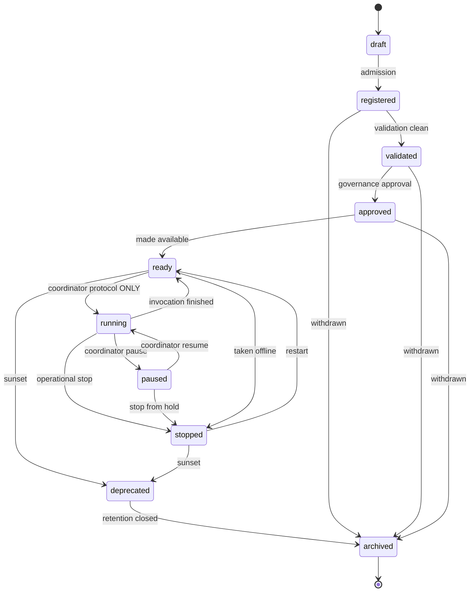

# 03 — Agent Lifecycle · دورة حياة الوكيل

**Section 03 implementation — ten states: a governance path and an
operational theatre, cleanly separated.**

---

## Rules

- **Governance half** (draft → registered → validated → approved → ready):
  driven by the public `transition()` API; records enter as `registered`
  at admission regardless of the draft's claimed state.
- **Operational half** (running / paused): `transition()` refuses these
  targets outright. The only entrance is the `OperationalGate` — created
  inside `AgentRuntimeRegistry.create()` (static factory, private method
  access) and held exclusively by the execution coordinator. External code
  cannot forge a running agent (tested).
- **Only `ready` agents run** — the coordinator refuses any other state,
  plus `critical`/`offline` health.
- After every invocation (success or failure) the agent returns to
  `ready`; failure additionally degrades health to `warning` with the
  error noted.
- `archived` is terminal; withdrawal to `archived` is possible from every
  pre-operational governance state.
