# 04 — Registry & Admission · السجل والقبول

**Sections 01–02 implementation — the governed store and the fail-closed
admission pipeline.**

---

## Registry diagram

```mermaid
flowchart TB
    C[candidate agent record] --> V["AgentRecordValidator<br/>shape · category · identity · dependencies ·<br/>contract · permissions · version · capability refs"]
    V -->|invalid| RJ["admission-rejected (audited)<br/>full issue list · nothing stored"]
    V --> D{duplicate id?}
    D -->|yes| RJ
    D --> ADM["ADMIT: version timeline +<br/>health baseline + registry.register"]
    ADM --> REG[("AgentRuntimeRegistry<br/>records enter as `registered`")]
    REG --> Q["queries: byLifecycle · byCategory ·<br/>byCapability · supportingMode"]
    REG -.->|"OperationalGate<br/>(coordinator-only)"| X["running / paused"]
    style RJ fill:#3a1f2a
    style ADM fill:#1f3a2a
```

## The agent record (Section 01)

Thirteen governed fields — id, name, description, version, category,
capabilities, dependencies, owner, permissions, policies, metadata,
lifecycle, health — plus `supportedModes` (min 1 of the seven) and the
runtime manifest.

## The runtime manifest (Section 02)

Wraps the frozen Phase-1 `AgentManifest` (`base`) and adds: semantic
version (must equal the record's), capabilities, requiredSkills,
requiredKnowledge, requiredTools, dependencies, execution contract
(timeout ceiling 300 000 ms; `retryable ⇒ idempotent` law), inputs,
outputs and policies (blocking/advisory).

## Admission laws

- Every check runs; a rejection reports the complete issue list and is
  audited (`admission-rejected`) — nothing partial lands.
- Record id must equal `manifest.base.id`; record version must equal
  `manifest.version`.
- Capability references resolve ONLY when a resolver is wired
  (`knownCapabilityIds` option — the population capability registry when
  present). Without a resolver the references are recorded, not resolved:
  an honest, documented deferral, not a silent pass of bad data — the
  shape is still schema-checked.
- Duplicates are refused; versions live on the shared `VersionTimeline`
  (upgrades/rollbacks under the population layer's rules).
