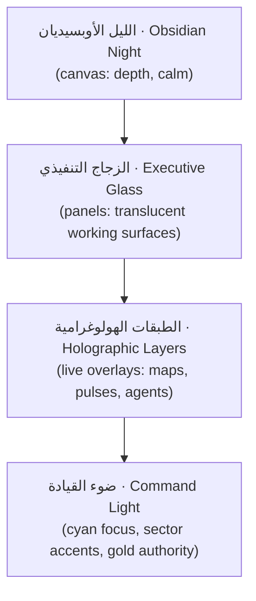

# Chapter 02 — Visual Language

**The Executive Design Language: how SADEED surfaces are built, layered and read.**

---

## The Executive Design Language in one view



Four strata, always in this order. The canvas is darkest and stillest; each stratum above
it is lighter, livelier and rarer. Reading any SADEED screen means descending from light
(what matters now) into glass (the working context) into night (everything else).

## Glassmorphism — الزجاج التنفيذي

Glass is SADEED's working material: panels are translucent so _depth is information_ —
you always sense there is a world behind the panel you're using.

Rules of glass:

- Glass = background at 55–75% opacity of a `--nx-surface`-family tone + `backdrop-blur`
  of 12–24px + a 1px border at 8–14% white + inner top highlight at 4% white.
- Glass never stacks more than **two deep**. A glass panel over a glass panel over glass
  is mud, not depth.
- Text never sits on raw glass over busy content: glass panels that carry body text add a
  scrim (see Chapter 06) to guarantee contrast.
- Glass is for _containers_. Controls (buttons, inputs) are solid or near-solid — the
  hand should never doubt what it's touching.

## Holographic Layers — الطبقات الهولوغرامية

The holographic stratum is where SADEED feels alive: the glowing Kingdom map, sector
pulse halos, agent presence rings, the cinematic background signature. Holography is a
_display_ register, never a _control_ register:

- Holographic elements are non-interactive or single-tap (open/inspect) only.
- They render **behind or beside** decision content, never on top of it.
- Their motion is slow (≥ 4s cycles), low-amplitude, and pausable under
  `prefers-reduced-motion`.
- Their color comes exclusively from sector accents and the cyan family — holography
  never uses status colors (a glowing red map edge would be a false alarm).

## Executive Panels — الألواح التنفيذية

The panel is the atomic unit of screen composition (cards, Chapter 08, live inside
panels). Every panel has the same anatomy, in RTL order:

```
┌──────────────────────────────────────────┐
│ العنوان (3 words max)     [status chip]  │  ← header row, 48px
│ ــــــــــــــــــــــــــــــــــــــــ │
│                                          │
│              content zone                │  ← one idea only
│                                          │
│ آخر تحديث · المصدر            [action]   │  ← footer row, 40px, optional
└──────────────────────────────────────────┘
```

- One panel = one idea (Principle 5). A panel needing two headers is two panels.
- Panel headers are the only place small-caps-style labels are allowed.
- The footer always carries data provenance (time + live/simulation) when the panel shows data.

## Information Density — كثافة المعلومات

SADEED runs three named density registers; every screen declares one:

| Register             | Where                   | Objects per viewport | Row height |
| -------------------- | ----------------------- | -------------------- | ---------- |
| **مجلس** Boardroom   | /, boardroom, cinema    | ≤ 5                  | ≥ 64px     |
| **قيادة** Command    | dashboards, hcis, exec  | ≤ 9                  | 48–56px    |
| **تشغيل** Operations | tables, logs, registers | ≤ 16                 | 36–44px    |

Density never changes _within_ a screen without a disclosure step (expanding a panel may
raise its register by one). Mixing Boardroom hero numbers with Operations tables on one
surface is forbidden — link between them instead.

## Visual Rhythm — الإيقاع البصري

Rhythm is repetition with a beat: identical panel gaps (Chapter 05), identical header
heights, identical corner radii per component class. The eye should be able to predict
where the next panel starts before seeing it. Rhythm breaks are _meaningful_: the one
element allowed to break the grid on a screen is, by definition, its most important
element — so break it once or never.

## Premium White Space — الفراغ الفاخر

Space is the most expensive material in the system; spending it is what makes SADEED feel
executive rather than operational.

- Minimum breathing: panel padding ≥ 24px in Command register, ≥ 32px in Boardroom.
- Hero numbers get empty space equal to at least their own height on both vertical sides.
- Never fill space because it exists. An intentionally empty column is a design element.

## Focus Hierarchy — تسلسل التركيز

Exactly four attention tiers per screen, allocated top-down:

1. **البطل (Hero)** — one element: the decision-relevant fact (KPI, alert, recommendation).
2. **السياق (Context)** — 2–4 panels that explain the hero.
3. **المحيط (Periphery)** — navigation, secondary metrics, timelines.
4. **الخلفية (Ambient)** — holographic/cinematic stratum; felt, not read.

Attention budget: the hero owns the strongest contrast, the only large type, and (if
warranted) the only glow. Nothing in tiers 2–4 may exceed the hero on any of those axes.

## Executive Readability — المقروئية التنفيذية

- Reading distance assumption: 60–75cm desktop, 3–5m boardroom wall. Boardroom register
  type sizes are set for the far distance (Chapter 04).
- Line length: 45–75 characters Arabic body text; numbers never wrap.
- Contrast: all reading text ≥ 7:1 against its resolved background (AAA), all UI labels
  ≥ 4.5:1 (Chapter 03 encodes the pairs).
- RTL is the native direction of every layout primitive: reading origin top-right,
  progressive disclosure opens leftward, charts label on the right. LTR content
  (English identifiers, numbers) is embedded with proper bidi isolation, never by
  flipping the layout.
