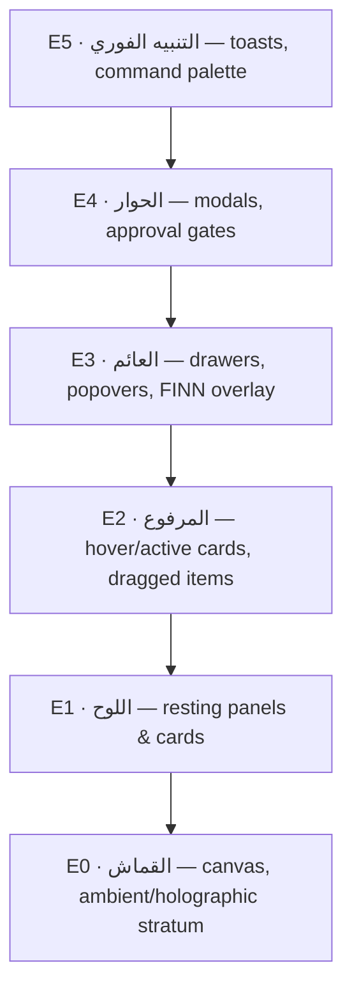

# Chapter 06 — Depth System

**Elevation, glass depth, blur, glow, shadow, holographic depth — the physics of SADEED.**

---

## The model

SADEED depth simulates a **dark control room with one soft overhead light**: surfaces
closer to the viewer are slightly lighter, blur what's behind them, and cast soft
obsidian shadows downward. Depth is _informational_ — elevation communicates interaction
proximity, glass communicates context-over-world, glow communicates live meaning.

## Elevation scale

| Level            | Surface tone            | Shadow (`#020811`) | Blur (backdrop) | Border (white) |
| ---------------- | ----------------------- | ------------------ | --------------- | -------------- |
| **E0** Canvas    | obsidian → ink          | none               | none            | none           |
| **E1** Panel     | surface @ 65%           | 0 8px 24px @ 45%   | 12px            | 8%             |
| **E2** Raised    | surface @ 72%           | 0 12px 32px @ 50%  | 16px            | 10%            |
| **E3** Floating  | card @ 78%              | 0 16px 40px @ 55%  | 20px            | 12%            |
| **E4** Dialog    | card @ 88%              | 0 24px 64px @ 60%  | 24px            | 14%            |
| **E5** Immediate | card @ 94% (near-solid) | 0 24px 64px @ 60%  | 24px            | 14%            |

Rules:

- Adjacent UI may differ by at most **one level**; jumps of two+ levels are reserved for
  modal moments (E1 → E4 with scrim).
- Higher = more opaque: urgency correlates with solidity. E5 is nearly solid because
  immediate messages must not compete with what's behind them.
- Every E2+ surface over content adds the overlay scrim beneath it (Chapter 03 §6).

## Glass depth & transparency rules

- Glass opacity band per level is fixed (table above) — a "lighter" glass is a different
  level, not a styling choice.
- Two-deep maximum (Chapter 02). The second glass layer must be ≥ E3.
- Text-bearing glass: resolved contrast must still meet Chapter 03 §9; if the content
  behind is unpredictable (map, cinema), add an ink scrim at 40% inside the panel.
- `backdrop-blur` is capped at 24px — beyond that GPU cost rises with no perceptual gain
  (performance budget is constitutional law).

## Glow — التوهج

Glow is _meaning made luminous_, never ambience:

| Glow           | Recipe                                    | Licensed use                 |
| -------------- | ----------------------------------------- | ---------------------------- |
| Focus glow     | cyan @ 35%, 24px                          | keyboard focus, active input |
| Sector pulse   | sector accent @ 30%, 32px, 4s breathe     | region halos on maps/chips   |
| Agent presence | `--nx-layer-agent` @ 25%, 24px            | FINN/agent active indicator  |
| Authority glow | gold @ 30%, 24px, static                  | the single approval element  |
| Critical ring  | critical @ 40%, 16px, 2-pulse then static | new critical alerts only     |

One glowing element per panel; two glows in a viewport must be different meanings. Glow
never appears on E0 text or on disabled elements.

## Shadow discipline

Shadows are always obsidian (never colored — colored "shadows" are glows and follow glow
law), always soft (blur ≥ 3× offset), always downward (light source never moves). No
inner shadows except the 1px glass top highlight.

## Holographic depth

The ambient stratum (E0) may simulate _far_ depth — parallax layers, the glowing Kingdom
map, cinema backgrounds — under three constraints: it never exceeds 8% of viewport
luminance, it never overlaps focus tiers 1–2 content (Chapter 02), and its parallax
amplitude ≤ 16px. Holographic depth is scenery through the cockpit window; the
instruments (E1+) always read against it.

## Layer hierarchy (z-index map)

`0` canvas/ambient · `10` panels · `20` raised · `30` sticky headers/rail · `40` drawers
& popovers · `50` modals+scrim · `60` toasts/palette · `70` FINN voice overlay (never
obscured). Hard-coded z-indexes outside this ladder are forbidden.
