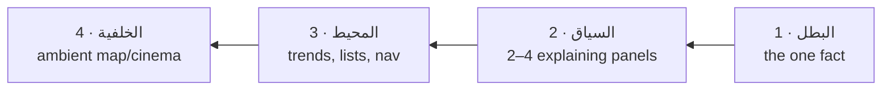

# Chapter 09 — Executive Dashboard Principles

**How decision surfaces are composed. This chapter is the contract every dashboard—
current and future—signs.**

---

## Visual hierarchy — the four tiers, applied

Every dashboard allocates its content to the Chapter-02 focus tiers **before** layout
begins:

The hero owns the top-right origin (RTL), ≥ 6/12 columns, the only Display-size number,
and (if any) the only glow. If stakeholders cannot agree on the hero, the dashboard is
not ready to be designed — that is a product decision, not a layout gap to hedge with
two heroes.

## Reading flow — مسار القراءة

RTL Z-path: top-right (hero verdict) → top-left (hero context/delta) → sweep down-right
(supporting panels) → bottom-left (deep links, provenance). Panel order follows the
executive's mental question sequence:

**هل أنا بخير؟ → أين الانحراف؟ → لماذا؟ → ماذا تنصح يا FINN؟ → ماذا أقرر؟**

(Am I fine? → Where is the deviation? → Why? → What does FINN advise? → What do I decide?)

Every dashboard must be walkable in that exact order without a single backtrack. A layout
that forces the eye to jump back up violates this chapter.

## Information density

Dashboards run the **Command register** (Chapter 02): ≤ 9 top-level objects. The
escape valve for "we need more" is depth, not density: drawers, drill-downs and the
Operations register live one click away. KPI grids cap at 4 across desktop (6 on 4K) —
beyond that, numbers stop being read and start being wallpaper.

## Executive focus

- **One screen, one question.** A dashboard that answers compliance *and* finance is two
  dashboards sharing a nav entry.
- Peripheral data auto-dims: when an alert elevates to hero, context panels drop to 72%
  content opacity until acknowledged — focus is managed, not hoped for.
- Numbers the executive cannot act on (vanity metrics) are banned from tiers 1–2.

## Decision support

Decision anatomy on every dashboard (mirrors the Executive Intelligence decision model):

| Zone | Content | Card |
|---|---|---|
| الوضع Situation | hero KPI/verdict | Executive Card |
| الدليل Evidence | trends, comparisons | Analytics Cards |
| التوصية Recommendation | FINN's advice + confidence | FINN Card |
| البوابة Gate | human approval, gold-marked | FINN Card (gate variant) |

The gate is always last in reading order and always explicit — the constitution's visual
guarantee of the architecture's "no auto-execution" law.

## Progressive disclosure — الكشف التدريجي

Three depths, fixed interaction cost:
1. **Glance** (0 clicks): verdicts, deltas, sparklines.
2. **Inspect** (1 click): drawer/panel expansion with full chart, breakdown, history.
3. **Investigate** (2 clicks): the Operations register — tables, logs, exports.

Nothing requires > 2 clicks from glance to raw record. Nothing at depth 2–3 auto-surfaces
to depth 1 except by *state* (an alert earning hero rank).

## No clutter — بلا ضوضاء

Bans, absolute: decorative stock imagery · more than one accent family per dashboard ·
badges on badges · legends restating obvious series · gridline forests (max 4 horizontal
guides per chart) · red/green tick-noise on stable KPIs (deltas under the noise threshold
render neutral) · any widget whose removal changes no decision (Principle 5 test, applied
per release).

## Premium simplicity — البساطة الفاخرة

The dashboard should feel like a well-run briefing: short, confident, already prioritized.
Practically: open with the verdict, never with a menu of charts; prefer one excellent
chart to three adequate ones; let whitespace do the separating that boxes and rules would
do crudely; and end with provenance (آخر تحديث، المصدر، شارة المحاكاة) — quiet proof that
the calm above is earned, not cosmetic.
