# 01 — Shell Registry Architecture · بنية سجلات الصدفة

**Shell Population Phase 5 · v1.0 — the infrastructure that lets the Adaptive
Shell RECEIVE future skills, agents, workflows and knowledge without one line
of Core change. No business logic, no enterprise data, no hardcoded content.**

---

## Position in the architecture

```mermaid
flowchart TB
    subgraph CORE["Frozen Core (immutable)"]
        OS[OS Runtime] --> INTEL[Executive Intelligence]
        INTEL --> PLATFORM[Platform Runtime]
        PLATFORM --> ORCH[Orchestration]
        ORCH --> EXEC[Executive Shell]
    end
    subgraph SHELL["Adaptive Shell (this layer)"]
        P1["Phase 1: manifests + flat registries + discovery"]
        NDK["Phase 2: NDK (builders / validators / compiler)"]
        P5["Phase 5: POPULATION — governance registries<br/>lifecycle · health · dependencies · permissions<br/>versioning · validation · events · discovery engine"]
        P1 --> P5
        NDK -.->|"produces packages that will feed"| P5
    end
    SHELL -->|"zero imports"| CORE
    style P5 fill:#1a2436,stroke:#8b7cf6
```

The population layer (`src/finn/adaptive-shell/population/`) **composes** the
frozen Phase-1 schemas (a `SkillRecord` embeds the Phase-1 `SkillManifest`
verbatim) and adds the governance the mandate demands. Nothing in Phase 1,
the NDK, or any Core layer was modified — one additive export line joins the
shell's public index.

## Module map

| Module                | Section    | Responsibility                                                                                                  |
| --------------------- | ---------- | --------------------------------------------------------------------------------------------------------------- |
| `types.ts`            | 05–08, 12  | closed vocabularies: lifecycle, health, dependency semantics, permissions, visibility, activation rules, events |
| `categories.ts`       | 04         | 12 seeded categories, runtime-extensible, typo-proof                                                            |
| `records.ts`          | 01, 02, 09 | zod-strict `CapabilityRecord` / `SkillRecord` + structured metadata                                             |
| `lifecycle.ts`        | 05         | 8-state machine, illegal jumps refused                                                                          |
| `health.ts`           | 06         | per-record health, worst-of aggregation                                                                         |
| `dependencies.ts`     | 07         | necessity×binding graph, cycle detection, topological order                                                     |
| `permissions.ts`      | 08         | deny-by-default grants over 8 actions                                                                           |
| `versioning.ts`       | 10         | semver algebra, timeline (upgrade/rollback rules), compatibility matrix                                         |
| `events.ts`           | 12         | 8 typed events, journaled, handler-safe                                                                         |
| `validation.ts`       | 11         | 7-check fail-closed pipeline                                                                                    |
| `registries.ts`       | 01, 02     | the two governed stores + human-gated activation protocol                                                       |
| `discovery-engine.ts` | 03         | `createShellPopulation()` — the single admission door                                                           |

## Laws

1. **Generic forever** — records describe _shape_, never content; the layer
   ships zero skills, zero agents, zero enterprise data.
2. **Fail closed** — invalid records never partially register; unknown rule,
   category, permission or event names are refusals, not warnings.
3. **Deterministic** — every component takes an injected `Clock`; the layer
   never reads wall time (mirrors the frozen runtime idiom).
4. **One door** — content enters registries only through the discovery
   engine's admission pipeline (doc 07).
5. **Human gate preserved** — nothing reaches `active` without the
   requested → approved → completed protocol under an `approval` grant.
