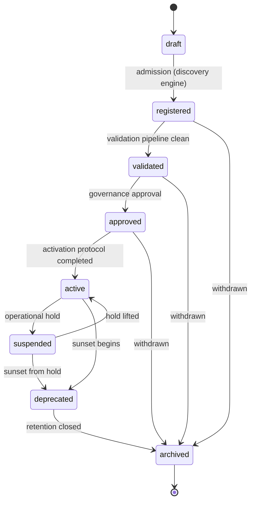

# 04 — Lifecycle · دورة الحياة

**Section 05 implementation — `LifecycleMachine`. Eight states, one legal
path to `active`, `archived` is terminal.**

---

## Rules

- **Stored records always enter as `registered`** — a candidate's claimed
  lifecycle is overwritten at admission; nobody self-declares `active`.
- **No jumps** — `assertTransition` throws with the allowed set listed;
  `draft → active` and `registered → active` are structurally impossible.
- **`archived` is terminal** — `isTerminal("archived") === true`; the error
  message says so explicitly.
- **`active` is unreachable by `transition()`** — the API refuses the target
  outright; the ONLY roads to `active` are the audited protocol
  (`requestActivation → approveActivation → completeActivation`, from
  `approved`) and the governed `resume(id, approver)` (from `suspended`).
  Both demand an approver holding the `approval` permission, re-check every
  activation rule, and journal completion events — there is no back door.
- **Removal windows** — a capability can be removed only while
  `registered`, `suspended` or `archived`, and only with zero dependents.
