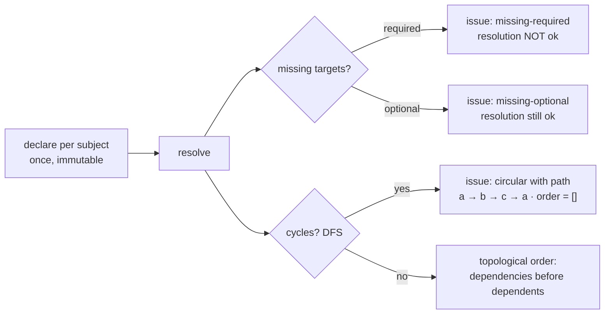

# 05 — Dependency Engine · محرك التبعيات

**Section 07 implementation — `DependencyEngine`. Two orthogonal semantics
per edge, cycle detection with the actual path, topological activation
order.**

---

## Declaration semantics

```ts
{ target: "cap.alpha", necessity: "required" | "optional", binding: "hard" | "soft" }
```

| | `hard` | `soft` |
|---|---|---|
| **`required`** | must resolve AND be lifecycle-healthy; missing/dead blocks resolution and surfaces in conflict detection | must resolve; degradation tolerated at runtime |
| **`optional`** | absence reported (`missing-optional`) but **never blocks** | absence reported, pure enhancement |

## Resolution



- `resolve()` returns `{ ok, issues, order }` — `ok` is false only for
  blocking issues (missing **required** or circular).
- Cycle reports carry the literal path (`a → b → c → a`), not just a flag.
- `order` is the safe activation sequence; it is empty whenever any cycle
  exists (never a partially-valid ordering).
- `dependentsOf(target)` powers removal guards (doc 02) and conflict
  detection (doc 07): you cannot remove what others still stand on.

## Interaction with activation

The `dependencies-active` activation rule (doc 02) reads this graph: every
**required** dependency's record must be lifecycle `active` before the
subject may complete activation — hard ordering is thus enforced twice,
statically (topological order) and dynamically (at the activation gate).
