# 06 — Validation · التحقق

**Section 11 implementation — `RecordValidator`. Seven checks, all executed,
all reported: a rejected record explains EVERYTHING wrong with it, and
nothing partial ever lands in a registry.**

---

## The seven checks

| # | Check | What it refuses |
|---|---|---|
| 1 | `manifest` (shape) | any deviation from the zod-strict record schema — missing field, extra field, wrong enum, malformed id/semver/date; for skills also record↔manifest identity drift (id, version) |
| 2 | `category` | categories not present in the `CategoryRegistry` (typos can't invent taxonomy) |
| 3 | `dependencies` | self-dependency; duplicate targets |
| 4 | `contract` | timeout above the 300 000 ms ceiling; `retryable` without `idempotent` |
| 5 | `metadata` | `updatedAt` before `createdAt`; empty owner |
| 6 | `permissions` | actions outside the eight-action model |
| 7 | `version` + `capability-references` | non-semver versions; skill references to unregistered capabilities |

## Flow

```mermaid
flowchart TB
    C[candidate record] --> S{zod shape parse}
    S -->|fail| R1[report: every shape issue<br/>validation-failed event]
    S -->|pass| CHK[checks 2–7 — ALL run,<br/>issues accumulate]
    CHK -->|any issue| R2[report: full issue list<br/>validation-failed event]
    CHK -->|clean| OK[valid=true → discovery engine<br/>continues admission]
    style R1 fill:#3a1f2a
    style R2 fill:#3a1f2a
    style OK fill:#1f3a2a
```

## Laws

- **Fail closed, report open** — the pipeline never stops at the first
  problem; operators fix a rejection in one round trip.
- **Validation ≠ admission** — the validator is pure (no writes); only the
  discovery engine (doc 07) mutates registries after a clean report plus
  its own duplicate/version/matching gates.
- **Context-aware** — the validator sees the live category registry,
  permission model and known capability ids; validity is judged against
  the Shell as it actually is, not a static rulebook.
