# 07 — Discovery Engine · محرك الاكتشاف

**Section 03 implementation — `createShellPopulation({clock})`. The single
admission door; everything the mandate lists (registration, validation,
duplicate detection, dependency resolution, version compatibility,
capability matching, conflict detection) is one pipeline.**

---

## Admission pipeline

```mermaid
flowchart TB
    C[candidate] --> V[validation — 7 checks, doc 06]
    V -->|invalid| F[validation-failed event<br/>full issue list · nothing stored]
    V --> D{duplicate id?}
    D -->|yes| F
    D --> VER{version timeline conflict?<br/>re-admission at new version}
    VER -->|yes| F
    VER --> M{capability matching<br/>matrix minimums satisfied?}
    M -->|no| F
    M --> A[ADMIT: timeline.record +<br/>dependencies.declare + health.report]
    A --> REG[registry.register<br/>capability-added / skill-registered]
    style F fill:#3a1f2a
    style REG fill:#1f3a2a
```

Order matters: nothing writes (timeline, graph, health, registry) until
every gate has passed — a rejected candidate leaves zero residue.

## Post-admission analyses

- `resolveDependencies()` — graph-wide resolution: missing required /
  optional, circular chains with paths, topological activation order
  (doc 05).
- `detectConflicts()` — cross-registry id collisions (one id may not be
  both a skill and a capability) and hard-required dependencies stuck in
  `deprecated`/`archived` states.

## Event trail (Section 12)

Every consequential act is journaled by the `PopulationEventBus`:

| Event                                                                   | Emitted by                                         |
| ----------------------------------------------------------------------- | -------------------------------------------------- |
| `capability-added` / `capability-removed`                               | capability registry                                |
| `skill-registered` / `skill-updated`                                    | skill registry                                     |
| `validation-failed`                                                     | discovery engine (with the stringified issue list) |
| `activation-requested` / `activation-approved` / `activation-completed` | activation protocol                                |

Handlers are isolated (a throwing listener never breaks the Shell) and the
journal — not any listener — is the audit authority.

## What discovery does NOT do (by design, this phase)

It loads no content. There is no glob scan wired to these registries yet —
Phase 5 builds the door and its locks; a later phase walks manifests
through it. That later wiring will feed NDK-compiled packages and Phase-1
discovered manifests into `admitCapability` / `admitSkill` unchanged.
